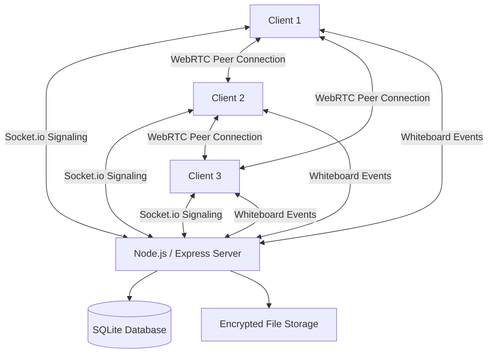

# HUDDLE — Real-Time Video Conferencing & Collaboration

<p align="center">
  <strong>A real-time video conferencing and collaboration platform built with WebRTC, Socket.io, and Node.js.</strong>
</p>

<p align="center">
  
  
  
  
  
</p>

---

## Overview

**Huddle** is a real-time video conferencing and collaboration application designed to bring meetings, communication, and teamwork into one platform.

Built using Node.js, Express, Socket.io, WebRTC, and SQLite, it provides peer-to-peer audio/video communication, encrypted in-call messaging, file sharing, and a collaborative whiteboard.

The application combines real-time communication with privacy-focused security mechanisms and a clean, minimalist interface.

**Project:** Task 4 — Real-Time Communication App  
**Category:** College Project  
**Architecture:** Client-server signaling with peer-to-peer WebRTC media  
**Frontend:** Vanilla JavaScript ES Modules

---

## Key Features

### 1. Real-Time Video Conferencing
- Peer-to-peer WebRTC mesh architecture.
- Supports multiple participants with dynamic video grid layouts.
- Real-time audio and video communication.
- Camera and microphone controls.
- Audio-level visualization using Web Audio API.
- Screen sharing support.

### 2. Security & Encryption
- DTLS-SRTP encryption for WebRTC media transport.
- End-to-end encrypted in-call chat using AES-256-GCM.
- PBKDF2-based key derivation from room passcodes.
- Optional ephemeral encryption keys stored in URL fragments.
- Server-side file encryption at rest using AES-256-GCM.
- JWT authentication using HTTP-only cookies.
- CSRF protection, Helmet security headers, and rate limiting.

### 3. File Sharing
- Direct peer-to-peer file transfers through RTCDataChannel.
- Chunk-based transfer using 64 KB chunks.
- Live upload and download progress.
- SHA-256 file integrity verification.
- Transfer cancellation controls.
- Encrypted server-side file storage.

### 4. Collaborative Whiteboard
- Shared real-time drawing canvas.
- Eight drawing tools:
  - Pen
  - Highlighter
  - Eraser
  - Line
  - Rectangle
  - Ellipse
  - Arrow
  - Text
- Color palette and adjustable stroke thickness.
- Undo and redo functionality.
- Canvas pan and zoom.
- PNG export.
- Real-time synchronization using Socket.io.
- Late-joiner whiteboard state synchronization.

### 5. Meeting & Host Controls
- Create and join meeting rooms.
- Remote participant muting.
- Participant removal.
- Room locking.
- Meeting termination.
- Meeting history and room management.

### 6. Admin Dashboard
- Protected administrative panel at `/admin`.
- First registered user receives admin privileges.
- Room overview and management.
- Global room termination controls.

### 7. User Interface
- Minimalist interface inspired by modern collaboration applications.
- Light-themed dashboard.
- Neutral dark meeting interface.
- Responsive video grid.
- SVG-based icons.
- CSS variables for consistent design tokens.
- No frontend frameworks or animation libraries.

---

## Tech Stack

| Layer | Technologies |
|---|---|
| Runtime | Node.js 18+ |
| Backend | Express 5 |
| Real-Time Communication | Socket.io 4 |
| Database | SQLite, better-sqlite3 |
| Database Optimization | SQLite WAL Mode |
| Authentication | bcryptjs, JWT Cookies |
| Security | Helmet, CSRF Protection, express-rate-limit |
| Video & Audio | WebRTC, RTCPeerConnection |
| Audio Processing | Web Audio API, AnalyserNode |
| Encryption | Web Crypto API, AES-256-GCM |
| File Integrity | SHA-256 |
| Frontend | HTML5, CSS3, Vanilla JavaScript ES Modules |
| Testing | Playwright |

---

## System Architecture

Huddle uses a client-server architecture for authentication, room management, and signaling, while WebRTC handles peer-to-peer media communication.



### Architecture Components

| Component | Responsibility |
|---|---|
| Express Server | HTTP routes, authentication, and application logic |
| Socket.io | Real-time signaling and collaboration events |
| WebRTC | Peer-to-peer audio, video, and data communication |
| SQLite | Users, rooms, files, and application records |
| Web Crypto API | Browser-side chat encryption |
| Node Crypto | Server-side file encryption |
| Playwright | Multi-client end-to-end testing |

---

## Project Structure

```text
huddle/
│
├── server/
│   ├── app.js
│   ├── server.js
│   ├── config.js
│   │
│   ├── db/
│   │   ├── database.js
│   │   └── schema.sql
│   │
│   ├── middleware/
│   │   ├── auth.js
│   │   ├── security.js
│   │   └── rateLimiter.js
│   │
│   ├── routes/
│   │   ├── auth.js
│   │   ├── rooms.js
│   │   ├── files.js
│   │   └── admin.js
│   │
│   ├── sockets/
│   │   ├── index.js
│   │   └── signaling.js
│   │
│   └── crypto/
│       └── serverCrypto.js
│
├── public/
│   ├── index.html
│   ├── dashboard.html
│   ├── lobby.html
│   ├── room.html
│   ├── admin.html
│   │
│   ├── css/
│   │   ├── variables.css
│   │   ├── main.css
│   │   ├── room.css
│   │   └── whiteboard.css
│   │
│   └── js/
│       ├── api.js
│       ├── crypto.js
│       ├── signaling.js
│       ├── rtc.js
│       ├── files.js
│       └── whiteboard.js
│
├── tests/
│   ├── test-milestone1.js
│   └── e2e/
│       └── huddle.spec.js
│
├── scripts/
│   ├── generate-cert.js
│   └── start-https.js
│
├── UI_CHECKLIST.md
├── SECURITY.md
└── package.json
```

---

## Getting Started

### Prerequisites

Make sure you have installed:

- Node.js 18 or later
- npm
- A modern browser with WebRTC support

### 1. Clone the Repository

```bash
git clone https://github.com/abhishek-s-gupta/huddle.git
cd huddle
```

### 2. Install Dependencies

```bash
npm install
```

### 3. Seed Demo Accounts (Optional)

```bash
npm run seed
```

### 4. Start the Application

```bash
npm start
```

Open the application:

```text
http://localhost:3000
```

> Camera and microphone access generally requires HTTPS or localhost. For testing across devices on a local network, use the HTTPS setup below.

---

## Demo Credentials

After running the demo seeder:

| Role | Email | Password |
|---|---|---|
| Admin | admin@huddle.local | password123 |
| Member | user@huddle.local | password123 |

New users can also register using the account creation option.

---

## Testing Across Devices (LAN)

To test video conferencing between two devices connected to the same Wi-Fi network, Huddle provides an automated local HTTPS certificate generator.

### Step 1 — Generate Certificates

```bash
npm run cert
```

This generates:

```text
certs/
├── key.pem
└── cert.pem
```

### Step 2 — Start HTTPS Server

```bash
npm run start:https
```

### Step 3 — Connect Devices

1. Connect both devices to the same Wi-Fi network.
2. Start the HTTPS server.
3. Open the displayed LAN address on the second device.
4. Accept the local self-signed certificate warning if appropriate for your development environment.
5. Sign in and join the same meeting room.
6. Grant camera and microphone permissions.

Both devices can now establish a WebRTC peer connection.

---

## TURN Server Configuration

Huddle uses a public STUN server by default to assist with peer connectivity.

For networks where direct peer-to-peer connectivity is unavailable, a TURN relay server may be required.

The application supports configuring TURN credentials through environment variables.

```env
TURN_URLS=turn:yourdomain.com:3478
TURN_USERNAME=your-turn-username
TURN_CREDENTIAL=your-turn-password
```

A production deployment should use properly secured TURN credentials and valid TLS certificates where applicable.

---

## Keyboard Shortcuts

| Key | Action |
|---|---|
| `M` | Toggle microphone |
| `V` | Toggle camera |
| `S` | Start or stop screen sharing |
| `W` | Open or close whiteboard |

---

## Automated Testing

Huddle includes a Playwright-based end-to-end testing suite.

The tests launch multiple Chromium browser sessions with simulated media devices to verify core meeting functionality.

### Test Coverage

1. User registration and authentication.
2. First-user administrator promotion.
3. Meeting creation and joining.
4. Lobby camera and microphone preview.
5. Multi-client WebRTC connection.
6. Microphone mute propagation.
7. Screen-sharing broadcast.
8. Encrypted chat message exchange.
9. Peer-to-peer file transfer.
10. Server-side encrypted file handling.
11. SHA-256 file integrity verification.
12. Real-time whiteboard synchronization.
13. Late-joiner whiteboard state synchronization.
14. Room locking and remote muting.
15. Meeting termination.

### Run Tests

```bash
npm test
```

---

## Security Considerations

Security is integrated into the application's communication and backend layers.

- HTTP-only JWT cookies for authentication.
- SameSite cookie restrictions.
- CSRF protection.
- Helmet security headers.
- Rate limiting for sensitive endpoints.
- bcryptjs password hashing.
- DTLS-SRTP-protected WebRTC media transport.
- AES-256-GCM encrypted chat messages.
- AES-256-GCM encrypted server-side file storage.
- SHA-256 integrity verification for file transfers.
- Protected administrative routes.

For implementation details and the project's threat model, see [`SECURITY.md`](SECURITY.md).

**Important:** WebRTC's DTLS-SRTP protects media transport between peers. The in-call chat uses a separate application-level encryption mechanism. These are distinct security layers and should not be described as one unified end-to-end encryption system.

---

## Design Philosophy

Huddle follows a restrained visual design approach focused on usability and clarity.

- Minimalist layouts.
- Neutral color palette.
- Consistent spacing and typography.
- Clear meeting controls.
- Responsive participant grid.
- Lightweight frontend without framework dependencies.
- No unnecessary gradients or decorative UI elements.

The goal is to keep the interface focused on communication rather than visual complexity.

---

## Future Improvements

Potential improvements for future versions include:

- SFU-based media architecture for larger meetings.
- Redis-backed Socket.io scaling.
- Persistent distributed session management.
- Improved TURN credential management.
- Production deployment and monitoring.
- Expanded browser compatibility testing.
- More comprehensive automated security testing.

---

## License

This project is licensed under the MIT License.

See the [`LICENSE`](LICENSE) file for details.

---

## Author

**Abhishek Gupta**

- GitHub: [abhishek-s-gupta](https://github.com/abhishek-s-gupta)
- LinkedIn: [Abhishek Gupta](https://www.linkedin.com/in/abhishek-s-gupta)

---

<p align="center">
  <strong>HUDDLE — Connect. Collaborate. Communicate.</strong>
  <br/>
  Built with Node.js, WebRTC, Socket.io, and Vanilla JavaScript.
</p>
